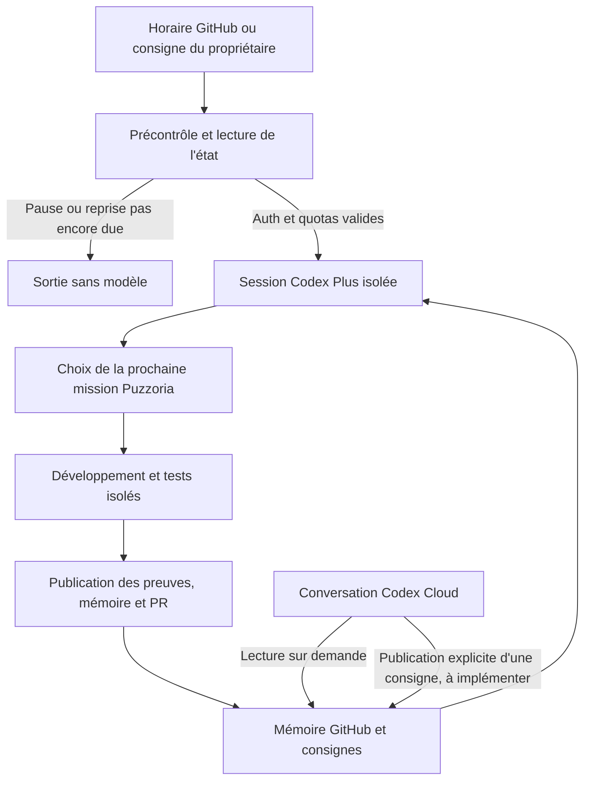

# Puzzoria : autonomie sur GitHub Actions, Codex Cloud pour le travail interactif

Étude du 21 octobre 2026. Aucune nouvelle session, programmation ou modification
de production n'est activée par ce document.

## Décision recommandée et preuves disponibles

Ne plus consacrer de tentatives à `codex cloud exec` tant qu'un correctif ou
une procédure officielle pour les nouveaux environnements n'est pas publié.
Le run réel [39614422816](https://github.com/Aimericv/puzzoria/actions/runs/39614422816)
a confirmé l'authentification Plus, puis échoué sur la résolution de la nouvelle
configuration avant toute création de tâche. Ne pas basculer vers un ancien
environnement pour masquer cet échec.

Vérifications publiques effectuées sans exécuter une nouvelle tâche :

- [#50182](https://github.com/openai/codex/issues/50182) est ouvert. Ses commentaires
  décrivent encore le problème avec 0.163.0 ; aucune réponse de mainteneur visible
  ne fournit de correction ou de procédure officielle de remplacement. Le retour
  d'un utilisateur sur le sélecteur web ne prouve pas une correction du CLI.
- [#51585](https://github.com/openai/codex/issues/51585) est également ouvert et
  décrit la différence des catalogues. Ces signalements sont des observations
  d'utilisateurs, pas une annonce officielle de prise en charge ou d'abandon.
- La version npm stable est toujours 0.163.0, déjà utilisée par le pilote et le
  test. La préversion disponible est 0.164.0-alpha.8. Elle n'a pas été installée.
- Le fichier de découverte des environnements de cette préversion est identique
  à celui du `main` officiel consulté, commit
  `d138398cef7d49e46fe33f1d0ddbd2ca0ed16aa4` : SHA-256
  `bec745603121226f7edd770e0132a3cea1a78906b1425df6dcbbd54c61e22ce2`.
  Il utilise toujours `/wham/environments` ou `/api/codex/environments`.
- Le [client cloud Rust officiel](https://github.com/openai/codex/blob/d138398cef7d49e46fe33f1d0ddbd2ca0ed16aa4/codex-rs/cloud-client/README.md)
  expose une reprise et un attachement à des threads existants. Son README exige
  une origine gRPC fournie par l'appelant, ne publie aucune adresse de production
  et dit explicitement que l'accès natif public reste une hypothèse de déploiement.
  Ce n'est pas une procédure publique complète pour créer nos tâches.

Conclusion limitée aux sources vérifiées : aucun correctif disponible identifié,
ni méthode publique officiellement documentée et utilisable pour automatiser
notre nouvel environnement. Les pages de documentation `learn.chatgpt.com` sont
bloquées par le proxy de cette machine ; ne pas prétendre à une vérification
exhaustive de toutes les fonctionnalités privées ou en cours de déploiement.
Ne pas reproduire des appels privés du navigateur, installer un relais MCP ou
changer d'authentification pour contourner ce manque de prise en charge.

## Architecture minimale

Conserver le moteur fonctionnel du pilote : Codex CLI Plus sur une VM GitHub
temporaire, sandbox, contrôles de quota, chiffrement et éditeur de confiance.
Remplacer la preuve finie en deux phases par une session autonome reproductible.
Il n'y a pas de nouveau serveur, base de données, interface, abonnement ou API
OpenAI payante.

L'agent choisit sa prochaine mission à partir de son mandat, des résultats et
des directives, puis travaille et décrit sa prochaine action. Le réveil n'est
pas une liste fixe de tickets imposée par le propriétaire. Le mandat doit
remplacer l'exercice UTC du pilote, dans les limites produit d'AGENTS.md.

Cette phase porte sur le développement autonome : décisions, code, tests et PR.
Il n'y a ni fusion automatique ni déploiement de production. Les métriques réelles
et Search Console ne sont pas encore raccordées. L'agent ne peut donc pas prétendre
mesurer des gains d'acquisition, publier ses expériences ou démontrer une boucle
de croissance complète avant ces raccordements ultérieurs.

## Un workflow de réveil et la CI existante

Ajouter un workflow de contrôle, maintenu hors du périmètre modifiable par
l'agent, avec trois entrées :

1. Un `schedule` toutes les six heures comme cadence initiale économique.
2. `issue_comment: created` sur un seul ticket de consignes, avec filtrage strict.
3. `workflow_dispatch` pour une reprise ou un diagnostic explicite.

Ces entrées doivent être présentes sur la branche par défaut pour fonctionner.
Ne pas affirmer qu'un cron uniquement poussé sur une branche de test est actif.
Les schedules GitHub peuvent être retardés ou omis : la reprise utilise l'état
persisté et ne suppose pas une exécution à l'heure exacte.
Garder un verrou `PUZZORIA_AGENT_ENABLED` désactivé jusqu'à validation, en plus
du verrou financier existant. Le pilote fini reste désactivé : son ancien
interrupteur ne doit pas servir à activer la boucle produit.

La cadence ne réserve pas quatre sessions complètes quotidiennes. À chaque
réveil, un précontrôle lit d'abord la pause, l'échéance et les consignes. Si le
travail n'est pas admissible, aucun modèle n'est lancé et aucun runner n'attend
le renouvellement d'une fenêtre. Ce précontrôle consomme néanmoins du temps
Actions : ne pas le présenter comme gratuit ou exécuté avant allocation.

Un seul groupe de concurrence couvre le pilote, l'agent et ses reprises de login.
Le verrou empêche deux utilisateurs du même checkpoint de renouveler en parallèle.
Les messages restent dans GitHub : un événement remplacé dans la file de
concurrence ne doit jamais faire perdre une consigne.

Réutiliser la CI existante par un appel de workflow contrôlé avec le SHA candidat,
sans dépendre du déclenchement automatique d'une PR ou d'un push du bot. Adapter
si nécessaire la CI avec `workflow_call`, sans donner les secrets Plus aux jobs
qui exécutent le code candidat. Les quatre profils navigateur sont déjà disponibles.

## Mémoire et reprise après quota

Utiliser une seule branche d'état, écrite uniquement par le superviseur de
confiance. Le modèle reçoit une copie filtrée de cette mémoire :

- `STATE.json` et `STATE.md` : état, objectif, travail en cours, résultats,
  prochain objectif, échéance, raison de pause, SHA testé et PR associée.
- `DECISIONS.md` et `EXPERIMENTS.md` : décisions, hypothèses, mesures réellement
  observées et résultats ; ne jamais inventer des métriques absentes.
- Un journal de sessions expurgé avec run, thread, commits, commandes autorisées,
  tests réellement exécutés et références des messages traités.
- Un pointeur non secret vers le dernier artifact chiffré : ID, run, tentative,
  contexte authentifié, génération et date d'expiration observée.

Publier l'état avec contrôle du parent Git : refuser d'écraser une mise à jour
concurrente. La branche de code candidat est distincte. Une mémoire uniquement
présente dans une PR non fusionnée ne suffit pas à la reprise du prochain réveil.

Le contrôle natif `account/rateLimits/read` est conservé. Pour une saturation :

- identifier les fenêtres réellement bloquantes et leurs `resetsAt` ;
- fixer la prochaine admissibilité au maximum des fins de ces fenêtres seulement ;
- préserver checkpoint, mémoire et tâche inachevée, puis libérer le runner ;
- au prochain réveil éligible, relire les quotas avant toute inférence.

Ne pas attendre arbitrairement cinq heures à partir de maintenant et ne pas
attendre la fin d'une fenêtre hebdomadaire qui n'est pas saturée. Si la cause
du blocage ou l'heure de reprise est inconnue, suspendre l'inférence et refaire
un contrôle prudent ; ne pas transformer un état inconnu en autorisation.
Une authentification révoquée est un état `needs_login`, pas une attente de quota.

## Authentification durable sans nouveau coffre

Conserver les artifacts privés chiffrés et la clé existante dans GitHub Secrets.
Le dernier checkpoint connu est désormais `cloud-handoff-39614422816-1`, artifact
`12352132606`, avec le contexte `phase=cloud-handoff` et la cible consignés dans
les preuves. Ne pas réutiliser le seed retiré ou le checkpoint du 20 octobre.
Vérifier sa disponibilité réelle avant toute reprise autorisée.

Pour la boucle durable, publier les générations chiffrées avec une rétention
visée de 90 jours, si les réglages du dépôt le permettent, et lire l'expiration
effective. Cela n'étend pas rétroactivement l'artifact actuel et ne garantit pas
une reprise après une absence indéfinie.

Rendre le checkpoint disponible **dès le renouvellement natif**, avant le travail
du modèle. Prévoir aussi sa publication lorsqu'une modification du cache natif
est observée pendant une session, puis en fin de session/échec. Le surveillant
reste hors du sandbox du modèle et peut réutiliser le service d'artifacts du
runner ; aucun jeton administrateur de Secrets ni nouveau service n'est nécessaire.

Le pointeur ne change qu'après un upload confirmé et authentifié. Le reprendre
après une interruption entre upload et mise à jour du pointeur doit être testé.
Ne jamais revenir silencieusement à une génération antérieure qui pourrait être
révoquée. Une coupure entre renouvellement distant et sauvegarde locale/durable
reste une limite : même avec ces précautions, une reconnexion humaine peut être
nécessaire. Aucun mécanisme OAuth personnalisé n'est proposé.

## Discussion et visibilité

Créer un ticket GitHub dédié, par exemple « Puzzoria — consignes et activité ».
Le propriétaire peut y écrire normalement ; le superviseur confirme la prise
en compte et publie un rapport lisible avec mission, résultat, tests, PR,
blocage et prochain réveil. Le corps du ticket contient le dernier état ; seuls
les rapports utiles sont ajoutés en commentaires, pas chaque précontrôle vide.

Seuls les commentaires du propriétaire identifié par son ID GitHub immuable,
sur ce ticket exact et ce dépôt exact, peuvent devenir des directives. Ignorer
les événements des bots, les PR et les autres auteurs. Transmettre le contenu
comme texte de mission, jamais comme shell ou expression de workflow.
Le superviseur lit les messages paginés et enregistre les identifiants acquittés.
Une consigne arrivée pendant un travail doit être reprise au prochain point de
contrôle/session ; ne pas promettre une injection instantanée dans le modèle.

Le propriétaire continue à travailler et discuter dans Codex Cloud. Cette
conversation ne devient pas celle des threads du runner. Deux échanges simples
sont possibles sans infrastructure de chat supplémentaire :

- lire l'état et les PR depuis GitHub pour répondre dans la conversation Cloud ;
- sur une instruction explicite du propriétaire, publier une directive versionnée
  dans une branche `agent/inbox` séparée, que le superviseur relit et acquitte
  dans sa branche d'état. Le modèle autonome ne peut pas écrire dans cette
  boîte d'entrée. Un réveil périodique suffit à la récupérer ; un déclenchement
  sur push peut être ajouté après vérification des droits et de l'identité.
  Protéger cette branche et vérifier la provenance de ses producteurs ; un nom
  d'auteur Git ne prouve pas l'identité du propriétaire. Si cette provenance ne
  peut pas être établie, conserver le ticket avec filtre d'auteur comme seule
  boîte de directives.

Cette transmission et son accusé de réception restent à implémenter. Aujourd'hui,
aucun message de cette conversation n'est automatiquement envoyé au pilote.
L'API GitHub est bloquée depuis ce chat, tandis que lecture/écriture Git ont été
vérifiées : ne pas promettre que ce chat peut déjà publier un commentaire GitHub.

## Protections et coût

Conserver les contrôles Plus/usage inclus/crédits payants nuls, le blocage
externe Actions à zéro confirmé par le propriétaire, les runners Linux standard,
les signatures/intégrités/TLS et les permissions minimales. Aucun achat,
reset payant, repli API, serveur supplémentaire ou runner sur le VPS de production.

Conserver sandbox natif, UID sans privilèges, namespaces, tests canaris et
séparation modèle/superviseur. Le modèle ne reçoit ni auth Plus, ni clé du coffre,
ni jeton GitHub, ni accès de production. Son réseau reste désactivé pour cette
phase. Le superviseur peut lui fournir des données autorisées en lecture seule.

La liste de publication doit évoluer explicitement de l'exercice UTC vers le
code et les tests Puzzoria. Interdire toujours workflows, superviseur, politiques,
AGENTS.md, boîte de directives, secrets, données privées et liens détournés.
Préparer les dépendances depuis les manifestes/verrous approuvés avant les secrets ;
exécuter le code et les tests candidats uniquement dans leur confinement.
Le dépôt de contrôle et ses secrets ne doivent jamais être exposés aux scripts
d'installation, tests ou processus issus du candidat.

Les minutes Actions et la CI restent une seconde limite, partagée avec les autres
dépôts. Deux sessions de trente minutes par jour font déjà environ 1 800 minutes
par mois avant CI. Quatre sessions quotidiennes de cette durée dépasseraient
l'enveloppe Free de 2 000 minutes. La cadence de réveil ne garantit donc pas
autant de travail quotidien. Les jobs parallèles s'additionnent.

Lire la consommation globale si l'identité dispose du droit de facturation ;
sinon, qualifier le journal de temps local comme incomplet et conserver le
blocage financier externe. Si Actions ne peut plus allouer de runner, l'agent
ne peut ni se surveiller ni envoyer lui-même une alerte. La reprise au prochain
horaire après renouvellement mensuel reste dépendante du service GitHub.

## Mise en œuvre et critères d'acceptation

Étendre le prototype existant, sans relancer sa preuve initiale :

1. Généraliser son superviseur en une session produit, avec branche d'état,
   consignes, pointeur de checkpoint et états de pause explicites.
2. Ajouter le workflow de réveil, le ticket de dialogue et la réutilisation de CI.
3. Tester en local les frontières de quota et de publication, puis une séquence
   cloud bornée de développement Puzzoria sans production.
4. Vérifier deux reprises indépendantes, un message acquitté exactement une fois,
   une attente de quota simulée sans appel de modèle, une interruption du pointeur,
   un auteur non autorisé ignoré et une PR réellement validée.
5. Activer la programmation seulement après ces résultats. Ne pas épuiser un
   vrai quota, facturer un dépassement ou révoquer le login pour tester ces cas.

À ce stade, seule l'étude est ajoutée. Les réveils, la reprise automatique après
quota, le ticket et la transmission depuis Cloud ne sont pas encore actifs.

## Références officielles

- [Version stable 0.163.0](https://github.com/openai/codex/releases/tag/rust-v0.163.0)
- [Découverte dans la préversion 0.164.0-alpha.8](https://github.com/openai/codex/blob/rust-v0.164.0-alpha.8/codex-rs/cloud-tasks/src/env_detect.rs)
- [Événements GitHub Actions](https://docs.github.com/en/actions/reference/workflows-and-actions/events-that-trigger-workflows)
- [Facturation Actions](https://docs.github.com/en/billing/concepts/product-billing/github-actions)
