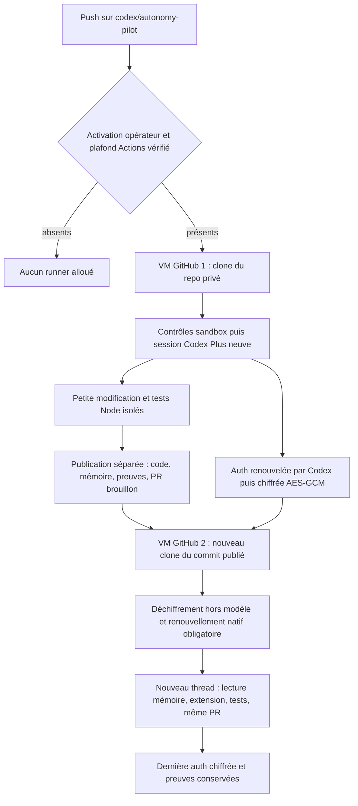

# Validation minimale Codex Plus sur GitHub Actions

Statut initial : implémentation préparée ; la preuve cloud n'est acquise que si
les **deux jobs réels** réussissent et publient leurs preuves. Aucun déploiement,
merge automatique, accès SSH ou connexion aux métriques de production.

## Ce que cette phase démontre

Deux jobs dépendants d'un workflow signifient deux machines éphémères et deux
threads Codex indépendants. GitHub lance la seconde session sans intervention du
PC. Le premier push et l'authentification initiale restent des opérations de
bootstrap. Ce pilote fini ne prouve pas encore une exploitation périodique
indéfinie : aucun cron n'est installé. Les schedules GitHub exigent un workflow
sur la branche par défaut ; leur activation viendra après cette validation.

Le travail de preuve est un utilitaire de fenêtres UTC entièrement écoulées,
utile pour de futures mesures de rétention. La seconde session ajoute des
fenêtres 7/30 jours après lecture de la mémoire de la première. Le superviseur
vérifie les cas limites indépendamment des tests écrits par l'agent.

## Fichiers et limites de confiance

| Élément | Rôle |
| --- | --- |
| `.github/workflows/autonomy-pilot.yml` | Deux runners Ubuntu, sérialisation du pilote, aucun déploiement |
| `.github/workflows/ci.yml` | Lint, types, tests, contenu, SEO, quatre profils E2E, build |
| `scripts/autonomy-pilot/runtime/` | Versions et intégrités npm verrouillées du CLI et du bootstrap |
| `scripts/autonomy-pilot/prepare.sh`, `requirements.toml` | UID sans privilèges et restrictions natives administrées |
| `run.mjs`, `rpc.mjs` | Supervision native, contrôle Plus/quota, arrêt des processus avant publication |
| `vault.mjs` | Auth chiffrée AES-256-GCM, nonce neuf, provenance repo/run/session authentifiée |
| `outputs.mjs`, `github.mjs` | Validation des sorties et publication GitHub séparée |
| `isolation.mjs`, `verify-task.mjs` | Tests bloquants du confinement et du résultat |
| `setup.mjs` | Bootstrap opérateur via le gestionnaire Git local, jamais embarqué dans le modèle |
| `agent/pilot/BOOT.md` | Mission et contrat de continuité |
| `agent/pilot/memory/STATE.json`, `STATE.md` | Créés par l'agent dans la branche de preuve |
| `agent/pilot/evidence/session-{1,2}.json` | Preuves générées par le superviseur, indépendantes des déclarations du modèle |

La branche de travail du superviseur est `codex/autonomy-pilot`. Le modèle publie
via un superviseur sur `codex/autonomy-proof`, dans une **PR brouillon vers la
branche pilote**, sans toucher `main`. Le superviseur n'accepte que les fichiers
de tâche `.mjs` et les deux fichiers de mémoire ; il refuse notamment les
workflows, `AGENTS.md`, les liens symboliques et les liens physiques. Il ajoute
lui-même les preuves machine. Les tests candidats restent dans le sandbox,
jamais exécutés avec l'identité du superviseur.

Le CLI natif conserve son auth dans un répertoire distinct du workspace. Les
outils du modèle ne peuvent lire ni ses fichiers d'auth, ni les secrets du superviseur,
ni l'environnement du runner. Ils n'ont ni réseau, ni sudo, ni Docker. La
séparation des namespaces PID est vérifiée : un `/proc` propre au sandbox reste
normalement lisible, tandis que l'environnement du superviseur et les variables
de secrets ne doivent pas être accessibles aux outils.
La
configuration administrée appartient à root, interdit d'autres profils, apps,
plugins, MCP, navigateur, hooks et recherche web. Les tests canaris doivent
réussir avant toute inférence ; aucun repli vers un accès intégral n'est prévu.
Le cache d'exécutables auxiliaires `CODEX_HOME/tmp/arg0-*` reste utilisable par
le sandbox natif ; interdire tout `CODEX_HOME` empêche ce dernier de démarrer.
Ubuntu 24.04 exige aussi Bubblewrap et le profil AppArmor fourni par Ubuntu,
chargé avant l'exposition des secrets. Le bootstrap suit la
[configuration officielle du sandbox](https://learn.chatgpt.com/docs/sandboxing#prerequisites),
sans désactiver globalement la restriction AppArmor des namespaces.

Le superviseur détient seul le jeton GitHub éphémère et la clé de chiffrement.
Le jeton personnel du gestionnaire Git sert exclusivement au bootstrap local.
Aucune clé API OpenAI, clé SSH, identité de production ou clé Cloudflare n'est
nécessaire. Les logs n'impriment ni le protocole Codex, ni l'auth brute.

## Authentification et reprise

La méthode utilise le mode ChatGPT **géré par Codex**, avec un login dédié au
pilote. Elle suit la [documentation OpenAI sur l'auth en CI privée](https://learn.chatgpt.com/docs/auth/ci-cd-auth).
Elle n'implémente pas de client OAuth, ne renouvelle pas les jetons elle-même et
ne réutilise pas le cache du Codex desktop actif.

Chaque session appelle `account/read` avec `refreshToken: true`. Le second job
doit observer un changement des jetons après cet appel natif ; sinon la preuve
échoue. L'ancien seed n'est pas fourni au second runner. Le fichier mis à jour
est chiffré avant de devenir un artifact GitHub. Le secret de déchiffrement reste
dans GitHub Secrets ; il n'est jamais stocké avec l'artifact ni dans le dépôt.

Les artifacts sont privés, minuscules et conservés 30 jours. Les seuls fichiers
exportés sont `auth.enc` et les preuves expurgées. Une substitution de run,
phase ou dépôt fait échouer la vérification authentifiée du checkpoint. La
seconde session lit la mémoire depuis le commit GitHub ; elle doit conserver un
nonce aléatoire absent de son prompt, et utiliser un ID de thread différent.

Après un échec normal, le `finally` rechiffre le dernier cache et l'upload est
tenté avec `always()`. Si le job 1 a réussi et le job 2 a échoué **avant tout
renouvellement**, GitHub peut relancer seulement le job échoué avec son checkpoint
du job 1. **Ne pas relancer aveuglément** si le job 2 a déjà renouvelé : son
checkpoint le plus récent est alors l'autorité ; le checkpoint du job 1 peut
être périmé. Le pilote refuse de relancer une première session dès que la branche
de preuve existe, pour empêcher un réensemencement silencieux avec un ancien
jeton. Il faut traiter une réparation explicitement à partir du dernier
checkpoint, ou réauthentifier et commencer une nouvelle preuve.

Limite de cette phase : un arrêt brutal avant upload peut perdre le dernier
refresh token ; l'expiration de rétention, une révocation ou un contrôle de
sécurité du fournisseur peut aussi imposer une nouvelle connexion humaine.
Un artifact n'est pas un coffre à mises à jour continues. Aucun renouvellement
indéfini ni reprise automatique après **toutes** les interruptions n'est promis
avant une preuve ultérieure. Si ce besoin apparaît pendant ce pilote, il
justifiera un stockage durable à écriture atomique avant d'étendre l'autonomie.

## Enveloppe gratuite

Avant allocation d'un runner, l'opérateur vérifie dans la [facturation GitHub](https://github.com/settings/billing)
un budget Actions de **0 $ de dépenses payantes**, avec arrêt de consommation
activé. Une alerte seule ne suffit pas : [documentation du blocage GitHub](https://docs.github.com/en/billing/how-tos/set-up-budgets).
Ce réglage externe est le plafond réel. Les variables d'activation ci-dessous
ne sont que des verrous de lancement, jamais un plafond financier.

Le pilote utilise des runners Linux standards inclus dans le forfait GitHub,
aucun runner plus grand, service, cache payant ou machine supplémentaire. Le
nombre de minutes et le stockage gratuits sont partagés avec les autres dépôts
du compte ; leur disponibilité réelle sera aussi vérifiée par les exécutions.
Les durées maximales des jobs (30 min par session de preuve, 90 min pour la CI)
limitent les processus bloqués ; elles ne sont pas une répartition stratégique
du quota de l'agent ni une limite future du nombre d'expériences.

Avant et après l'inférence, le superviseur exige un compte `plus`, une
autorisation d'usage inclus observable et des crédits payants observables à
zéro. Il refuse les informations manquantes, quotas épuisés et modes API. Il
n'appelle jamais un achat ou reset. L'épuisement du quota doit arrêter le pilote,
sans fallback payant. Aucun moyen de paiement ni secret d'achat n'est donné à
l'agent. L'opérateur ne doit pas activer de recharge automatique de crédits.

## Bootstrap opérateur

Depuis un checkout de confiance, Node 24.15+ et Git Credential Manager déjà
connecté au dépôt privé :

1. Installer seulement le runtime verrouillé :
   `npm ci --ignore-scripts --no-audit --no-fund --prefix scripts/autonomy-pilot/runtime`.
2. Créer un `CODEX_HOME` dédié hors dépôt avec permissions privées, y configurer
   `cli_auth_credentials_store = "file"` et `forced_login_method = "chatgpt"`,
   puis effectuer `codex login --device-auth`. Ne jamais copier l'auth de la
   session desktop active, ni transmettre un jeton dans le chat.
3. Définir `CODEX_PILOT_LOGIN_HOME` vers ce répertoire privé, puis exécuter
   `node scripts/autonomy-pilot/setup.mjs seed`. Le script chiffre les deux
   secrets pour la clé publique GitHub et autorise la création des PR par
   `GITHUB_TOKEN`, en conservant les permissions par défaut en lecture.
4. Après vérification humaine du blocage payant à 0 $, exécuter
   `node scripts/autonomy-pilot/setup.mjs enable-after-billing-check`.
5. Pousser la branche pilote. Aucun PC ne doit ensuite rester allumé pour les
   jobs, leur chaîne de reprise ou la PR de preuve.
6. Après succès du premier transfert chiffré, retirer le seed devenu obsolète :
   `node scripts/autonomy-pilot/setup.mjs retire-seed`. Conserver la clé et le
   **dernier** checkpoint chiffré tant que cette connexion reste utile.

Les modes de setup sont des commandes d'opérateur de confiance, pas des outils
du modèle. La variable `PUZZORIA_FREE_ACTIONS_VERIFIED=true` autorise la CI ;
`PUZZORIA_PILOT_ENABLED=true` autorise le pilote. Leur absence saute les jobs
avant allocation. `setup.mjs disable` referme ces deux verrous ; annuler à part
les jobs déjà lancés. Les supprimer ne remplace pas la révocation de l'auth si
elle est compromise. Le pilote ne peut ni administrer Secrets/variables/budget,
ni modifier ses workflows par son canal de publication.

## Critères de validation

- Deux jobs réussis, deux IDs de thread, seconde VM lancée par GitHub.
- PR créée par le premier runner, prolongée par le second ; code, tests et
  mémoire accessibles dans GitHub, avec des parents de commits cohérents.
- Contrôles canaris et tests indépendants réussis dans les deux sessions.
- Deuxième login issu de l'artifact chiffré, renouvellement natif observé,
  aucun seed en session 2 ; dernier checkpoint disponible.
- Preuves machine : compte Plus sans identifiant personnel, quotas avant/après,
  versions npm verrouillées, run/job/thread/commit et vérification de continuité.
- CI complète réussie sur Linux et E2E locaux corrigés. Le jeton automatique
  GitHub ne déclenche pas récursivement un événement `pull_request` : la PR de
  preuve porte un statut de vérification propre au pilote ; la CI du code
  d'infrastructure est lancée sur le push de la branche pilote.
- Aucun workflow de déploiement, merge ou accès production ajouté.

Les sorties `session-*.json` ne sont écrites qu'après les contrôles réels. Les
tests unitaires du superviseur ne remplacent pas les preuves cloud ni une
vérification du budget fournisseur. L'extension à une boucle produit complète
reste conditionnée à ces résultats, sans imposer de budgets par expérience.
